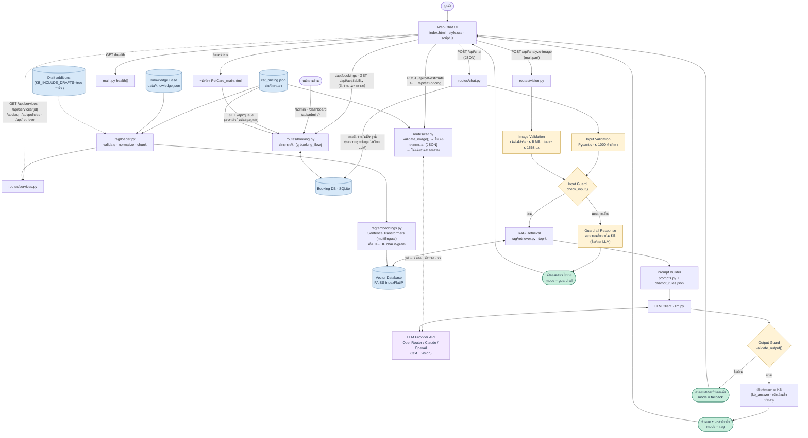

# System Architecture — PetCare Buddy

Rendered: [diagrams/architecture.png](diagrams/architecture.png) · [SVG](diagrams/architecture.svg) · source [diagrams/architecture.mmd](diagrams/architecture.mmd)

Every box maps to a file in `app/`; every endpoint shown exists and is covered by `tests/test_api.py`.

## Components

| Layer | File | Responsibility |
|---|---|---|
| Web UI | `app/static/index.html`, `style.css`, `script.js` | Chat, suggested questions, image upload, loading state, error banner with retry, source tags, clear conversation |
| API | `app/main.py`, `app/routes/*.py` | REST endpoints, request validation, error format |
| Input validation | Pydantic models in `app/models.py`; `validate_image()` in `routes/vision.py` | Length, blank, file type by decoding, size, dimensions |
| Input guard | `app/safety/guardrails.py: check_input()` | Regex rules (Thai + English) for prompt extraction, injection/jailbreak, privacy, diagnosis, fake promotions, discount demands |
| Knowledge Base | `data/knowledge.json` (official), `data/knowledge_draft_additions.json` (drafts, off by default), `data/chatbot_rules.json` | Business facts; behavioural rules |
| Loader | `app/rag/loader.py` | Validate (Pydantic), normalize (NFC, whitespace), chunk: 1 per service/policy/FAQ + profile + 4 group summaries + cat pricing table = 40 chunks |
| Embeddings | `app/rag/embeddings.py` | `sentence-transformers/paraphrase-multilingual-MiniLM-L12-v2`; automatic fallback to TF-IDF character n-grams if the model cannot load |
| Vector DB | `app/rag/retriever.py` | FAISS `IndexFlatIP` on L2-normalized vectors (cosine), persisted to `data/index/` with a content fingerprint |
| Prompting | `app/prompts.py` | System prompt with rules + canary token; `<knowledge>` context; `SOURCES:` citation line; JSON contract for vision |
| LLM | `app/llm.py` | Anthropic Claude or OpenAI (text + vision), selected by `LLM_PROVIDER` |
| Booking | `app/booking.py`, `app/routes/booking.py`, `static/admin.html` | Booking requests validated against the KB, stored in SQLite (`data/bookings.db`); staff confirm at `/admin`. Flow: [diagrams/booking_flow.png](diagrams/booking_flow.png) |
| Output guard | `guardrails.py: validate_output()` | Prices must exist in the KB (or be sums of 2–3 listed prices); blocks claimed bookings/refunds/payments/cancellations, granted discounts, diagnosis/medication, system-prompt leakage; redacts phone/email/ID numbers |
| Cat estimate | `app/cat_estimate.py`, `app/routes/cat.py`, `data/cat_pricing.json` | Vision model describes the cat (size, weight range, coat) as JSON; price computed in code from S04 + surcharge table; the table is also added to the Knowledge Base as chunk `pricing:cat` |
| Storefront + dashboard | `app/static/PetCare_main.html`, `app/static/dashboard.html` | Public 7-day queue board (queue numbers only) and staff dashboard (`ADMIN_TOKEN`) |
